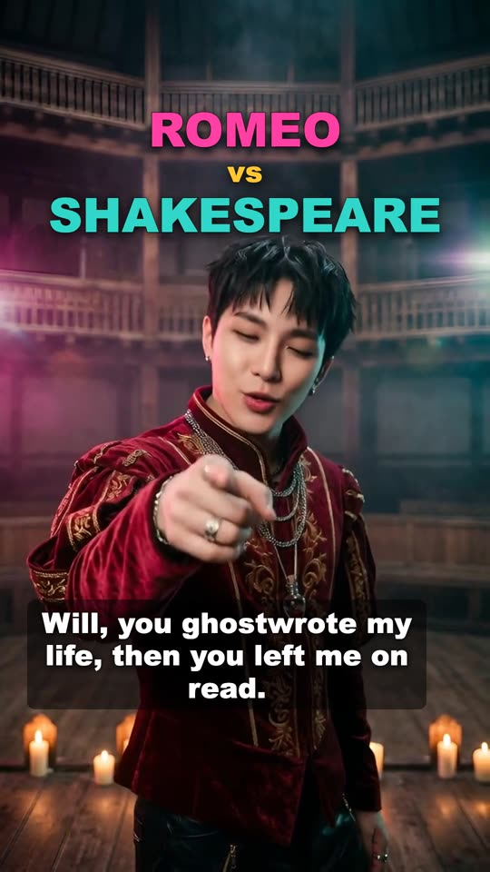
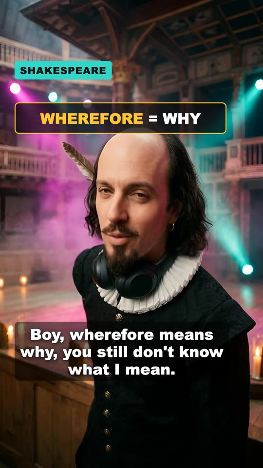
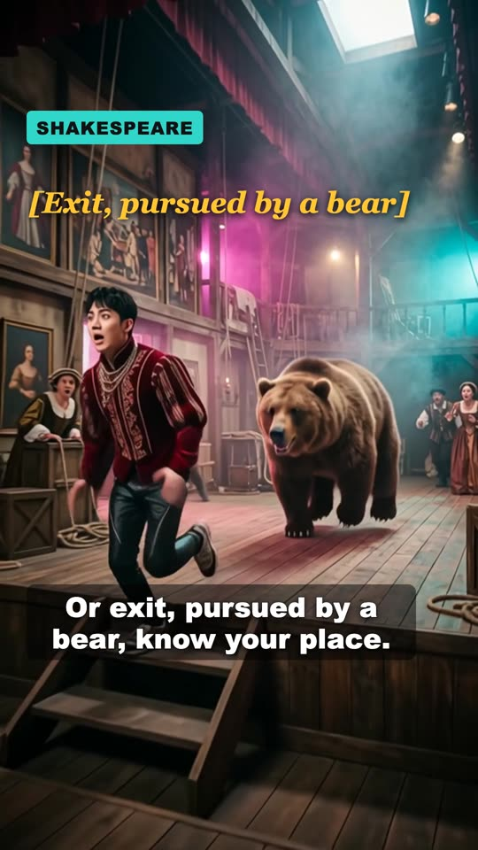

# AI Rap Battle MV: two characters, one song, a 60-second music video

A free Claude skill. You pick two characters with a beef, like Romeo vs Shakespeare. Claude writes the lyrics with you and plans a song where the two rappers sound different. It times every line, lists every picture and clip to make with the cost, and cuts it all into a vertical music video with captions.

Watch the example: [Romeo vs Shakespeare, a K-Pop rap battle (YouTube Short)](https://youtube.com/shorts/u4WrdMUoFC4)

| | |
|---|---|
|  |  |
|  | **Our example:** 59 seconds, 25 shots. **USD 4.13** in pictures and clips, plus ElevenLabs subscription credits for the song. |

## What's free and what costs money
| Step | Who does it | Cost |
|---|---|---|
| Lyrics, song plan, timing, shot list, checks, preview, captions, final edit | `battle.mjs` on your computer | Free |
| The song | ElevenLabs Music (website or API) | Subscription credits |
| Character sheets and first pictures | Any image AI (we used Nano Banana) | About USD 0.02 each |
| Lip-sync clips | A talking-avatar tool (we used Kling AI Avatar) | About USD 0.05 per second |
| Moving story shots | An image-to-video tool (we used Wan 3.0, 480p) | About USD 0.05 per second |

You don't need API keys: you can make every paid part on the websites and drop the files into the project folder. If you do have keys (ElevenLabs, CometAPI), `api.mjs` makes them for you. It shows the cost first and sends nothing until you add `--yes`.

## What's in the folder
| File | What it does |
|---|---|
| `SKILL.md` | The 11 steps Claude follows, plus the rules (no real living people, true facts, AI disclosure) |
| `battle.mjs` | The free tools: `new`, `plan`, `lines`, `retime`, `todo`, `segments`, `check`, `cut` |
| `api.mjs` | Optional: makes the song, transcript, pictures and clips with your own API keys |
| `example/romeo-vs-shakespeare/` | Our real project: lyrics, song timing, all 25 shot prompts, characters, fact cards, 3 stills. It doesn't include the song or the clips, so a preview cut shows cards where the clips will go |
| `test.mjs` | Tests (`node test.mjs`). They never call a paid service |
| `package.json` | What `npm i` installs: ffmpeg and puppeteer (a browser you never see, for the captions) |

## Install (about 5 minutes)
You need [Node.js](https://nodejs.org) 18 or newer and Claude Code (or the Code tab of the Claude desktop app).

1. Get the folder: on the GitHub page, click Code → Download ZIP, unzip it, and copy the `hype-meter-ai-rap-battle-mv` folder into `~/.claude/skills/` (create that folder if it isn't there).
2. Install ffmpeg and the browser once:
   ```
   cd ~/.claude/skills/hype-meter-ai-rap-battle-mv
   npm i
   ```
   The first time takes about 2 minutes and shows nothing until it's done. It also puts a copy of Chrome in `~/.cache/puppeteer`.
3. `node test.mjs` should end with `35 passed`.
4. In Claude, say: "rap battle MV: Cleopatra vs Julius Caesar, she's mad he never texts back."

## Try the example without spending anything
Files are written into the project folder, so copy the example somewhere first:
```
SKILL=~/.claude/skills/hype-meter-ai-rap-battle-mv
mkdir -p ~/rap-battle && cp -R "$SKILL/example/romeo-vs-shakespeare" ~/rap-battle/
cd ~/rap-battle
node "$SKILL/battle.mjs" lines romeo-vs-shakespeare
node "$SKILL/battle.mjs" todo romeo-vs-shakespeare
node "$SKILL/battle.mjs" cut romeo-vs-shakespeare --preview
```
`lines` prints when each of the 20 lines is sung. `todo.md` lists all 26 pictures and 23 clips with an estimate of about USD 4. The preview, `build/romeo-vs-shakespeare-preview.mp4`, takes about a minute. It is the whole 59-second edit, with a card showing each shot's prompt where its clip will go. It has no sound, because the song isn't included.

## API keys (optional)
```
export ELEVENLABS_API_KEY=...   # song and transcript
export COMETAPI_KEY=...         # pictures, lip-sync, motion clips
```
Keys stay on your computer. They're only sent to that company's API, in the request header. Every `api.mjs` command lists what it would make and what it would cost. Add `--yes` to actually send it, and `--only s02,s03` to make just those shots. Files you already have are skipped, so running the command again only makes what's missing.

## Honest limits
- The prices are what we paid in October 2026. AI services change prices and rules often.
- The website steps depend on those sites' menus, which change. The file names and the order of the steps stay the same.
- `api.mjs` is tested against recorded responses. Our video was made with the same services and the same request formats, through our own tools.
- AI clips sometimes have odd hands or gestures. Watch every one before the final cut.

MIT license. Made by Hype Meter: AI tools for people who don't code. Tested, not hyped.
